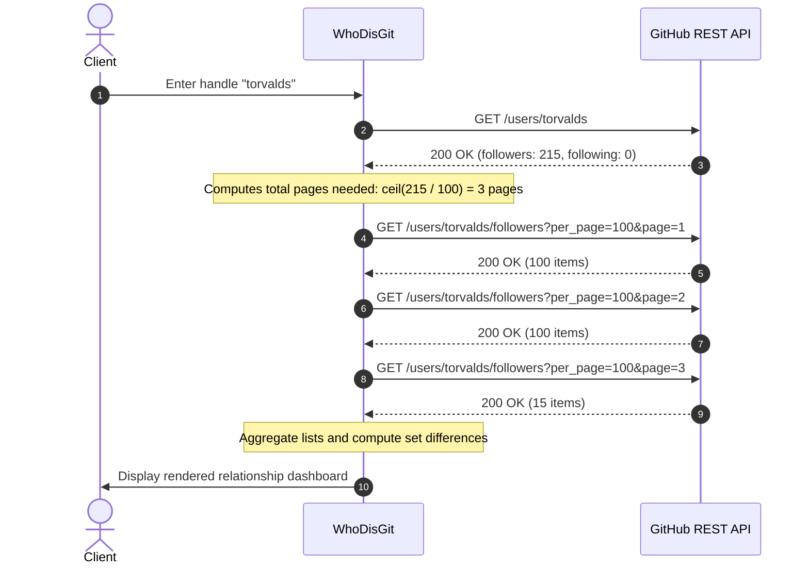

<!-- well-document · audit scorecard: G1:5 G2:5 G3:5 G4:5 G5:5 G6:5 · STATUS: PASS -->

[← Back to Documentation Index](README.md) · [Root Repository](../README.md)

# GitHub API Integration Guide

This document defines the REST API integration protocols, endpoint parameters, rate-limit governance, and pagination mechanics used by WhoDisGit.

---

## Table of Contents

- [API Provider & Protocols](#api-provider--protocols)
- [Endpoints Consumed](#endpoints-consumed)
- [HTTP Request Headers](#http-request-headers)
- [Pagination Strategy](#pagination-strategy)
- [Rate Limit Governance](#rate-limit-governance)
  - [Quotas & Tiers](#quotas--tiers)
  - [Header Extraction](#header-extraction)
- [Deep Linking & URL Parameters](#deep-linking--url-parameters)

---

## API Provider & Protocols

WhoDisGit queries the official **GitHub REST API v3** over HTTPS. All requests originate directly from the user's browser runtime using standard `window.fetch`.

- Base API URL: `https://api.github.com`
- Content Type: `application/json`
- Supported HTTP Method: `GET`

---

## Endpoints Consumed

| Endpoint | Purpose | Query Parameters | Response Model |
| :--- | :--- | :--- | :--- |
| `/users/{username}` | Resolves account existence and overall statistics. | None | `GithubProfile` |
| `/users/{username}/followers` | Fetches the accounts following the user. | `per_page=100`, `page={n}` | `GithubSimpleUser[]` |
| `/users/{username}/following` | Fetches the accounts followed by the user. | `per_page=100`, `page={n}` | `GithubSimpleUser[]` |
| `/users/{username}/repos` | Fetches public repositories for metric aggregation. | `per_page=100`, `page={n}`, `type=public` | `GithubRepo[]` |

---

## HTTP Request Headers

Every outbound request includes explicit compatibility and content negotiation headers:

```typescript
const headers: Record<string, string> = {
  'Accept': 'application/vnd.github.v3+json',
  'X-GitHub-Api-Version': '2022-11-28'
};

if (pat && pat.trim().length > 0) {
  headers['Authorization'] = `Bearer ${pat.trim()}`;
}
```

### Header Descriptions

- `Accept`: Pins the response payload schema to the v3 JSON specification.
- `X-GitHub-Api-Version`: Enforces consistent date handling and field formatting.
- `Authorization`: Conditionally attached when a Personal Access Token (PAT) is supplied.

---

## Pagination Strategy

GitHub restricts list endpoints to a maximum of 100 items per request (`per_page=100`). High-follower profiles require sequential page traversal:



The application checks the returned item array length on each request. If an array returns fewer than 100 items, pagination terminates immediately without firing extra requests.

---

## Rate Limit Governance

### Quotas & Tiers

GitHub enforces rate limits based on client IP or token identity:

| Tier | Authentication State | Request Quota | Scope Requirement |
| :--- | :--- | :--- | :--- |
| **Public / Anonymous** | No token provided | 60 requests per hour per client IP | None |
| **Personal Access Token** | Valid fine-grained or classic PAT | 5,000 requests per hour per account | Read-only public data (no scopes required) |

### Header Extraction

When an API response returns an HTTP 403 Forbidden status code, the response headers are parsed to extract rate limit telemetry:

```typescript
const rateLimitRemaining = response.headers.get('x-ratelimit-remaining');
const rateLimitResetUnix = response.headers.get('x-ratelimit-reset');

if (rateLimitRemaining === '0' || response.status === 403) {
  const resetDate = new Date(parseInt(rateLimitResetUnix || '0', 10) * 1000);
  const formattedResetTime = resetDate.toLocaleTimeString();
  // Display rate-limit notification with calculated reset timestamp
}
```

---

## Deep Linking & URL Parameters

WhoDisGit supports direct execution through URL query parameters for bookmarking and automated workflows:

| Parameter | Type | Default | Description | Example |
| :--- | :--- | :--- | :--- | :--- |
| `username` | String | None | Target GitHub account handle to query on component mount. | `?username=torvalds` |
| `pat` | String | None | Personal Access Token applied to authorization headers. | `?pat=ghp_example` |
| `raw` | Integer | `0` | If set to `1`, renders the raw JSON payload viewer with one-click copy. | `?raw=1` |

Parameters are parsed on initial mount using `window.location.search`. If a valid `username` is provided, data fetching begins automatically.
