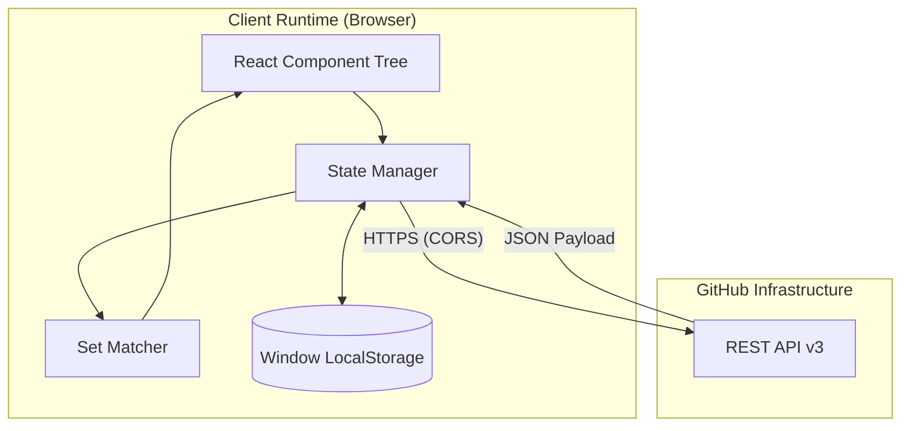
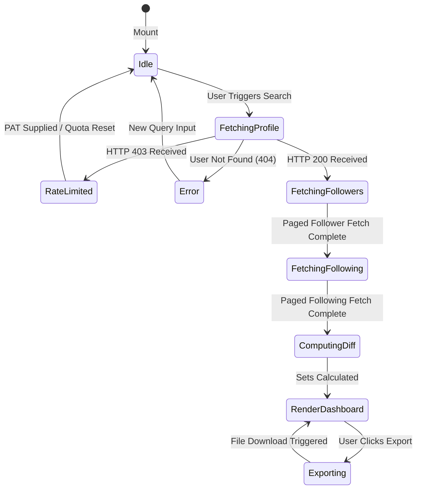

<!-- well-document · audit scorecard: G1:5 G2:5 G3:5 G4:5 G5:5 G6:5 · STATUS: PASS -->

[← Back to Documentation Index](README.md) · [Root Repository](../README.md)

# Architecture Specification

WhoDisGit is an entirely client-side web application designed to compute relationship subsets across GitHub follower networks. The application runs inside the user's browser without intermediate backend proxies or analytics collectors.

---

## Table of Contents

- [Core Principles](#core-principles)
- [Client Execution Boundaries](#client-execution-boundaries)
- [Relationship Difference Engine](#relationship-difference-engine)
  - [Mathematical Model](#mathematical-model)
  - [Algorithmic Complexity](#algorithmic-complexity)
- [State Machine & Data Flow](#state-machine--data-flow)
- [Data Structures & Type Contracts](#data-structures--type-contracts)
- [Persistence and Storage Safety](#persistence-and-storage-safety)

---

## Core Principles

1. **Zero Intermediate Telemetry**: Network traffic flows strictly between the user's browser runtime and `https://api.github.com`.
2. **Stateless Default**: Personal Access Tokens (PAT) remain in volatile React state by default unless explicit persistence is requested by the user.
3. **Deterministic Algorithmic Bounds**: In-memory list operations maintain linear time complexity $O(N + M)$ regardless of network size.

---

## Client Execution Boundaries

All state transitions and computations execute on the client thread:



---

## Relationship Difference Engine

### Mathematical Model

Let $U$ represent the target GitHub account.
Let $F_{ing}$ be the set of accounts followed by $U$:
$$F_{ing} = \{x \mid U \text{ follows } x\}$$

Let $F_{ers}$ be the set of accounts following $U$:
$$F_{ers} = \{y \mid y \text{ follows } U\}$$

The engine partitions user relationships into three mutually exclusive sets:

1. **Unfollowers ($S_{unf}$)**: Accounts followed by $U$ that do not follow back:
   $$S_{unf} = F_{ing} \setminus F_{ers}$$

2. **Fans ($S_{fan}$)**: Accounts following $U$ that $U$ does not follow back:
   $$S_{fan} = F_{ers} \setminus F_{ing}$$

3. **Mutual Connections ($S_{mut}$)**: Accounts with bidirectional follow status:
   $$S_{mut} = F_{ing} \cap F_{ers}$$

### Algorithmic Complexity

Naïve nested iteration yields $O(N \cdot M)$ complexity, causing browser thread stuttering for high-volume accounts. WhoDisGit utilizes hash sets for constant-time lookups:

1. Build follower login set $H_{ers} = \text{HashSet}(F_{ers})$ in $O(M)$ time.
2. Build following login set $H_{ing} = \text{HashSet}(F_{ing})$ in $O(N)$ time.
3. Filter $F_{ing}$ against $H_{ers}$ to derive $S_{unf}$ in $O(N)$ time with $O(1)$ lookup per item.
4. Filter $F_{ers}$ against $H_{ing}$ to derive $S_{fan}$ in $O(M)$ time with $O(1)$ lookup per item.
5. Filter $F_{ing}$ against $H_{ers}$ to derive $S_{mut}$ in $O(N)$ time with $O(1)$ lookup per item.

Total execution time complexity is strictly linear:
$$\mathcal{O}(N + M)$$

Space complexity is proportional to total network size:
$$\mathcal{O}(N + M)$$

---

## State Machine & Data Flow

The component lifecycle transitions through distinct status flags during query execution:



---

## Data Structures & Type Contracts

Core API models are strictly typed in `src/types/github.ts`:

```typescript
export interface GithubSimpleUser {
  login: string;
  id: number;
  avatar_url: string;
  html_url: string;
  type: string;
  site_admin: boolean;
}

export interface GithubProfile {
  login: string;
  id: number;
  avatar_url: string;
  html_url: string;
  name: string | null;
  company: string | null;
  blog: string | null;
  location: string | null;
  bio: string | null;
  twitter_username: string | null;
  public_repos: number;
  public_gists: number;
  followers: number;
  following: number;
  created_at: string;
  updated_at: string;
}

export interface GithubRepo {
  id: number;
  name: string;
  full_name: string;
  private: boolean;
  html_url: string;
  description: string | null;
  fork: boolean;
  stargazers_count: number;
  watchers_count: number;
  language: string | null;
  forks_count: number;
  open_issues_count: number;
  updated_at: string;
}
```

---

## Persistence and Storage Safety

WhoDisGit stores non-sensitive preferences and optional credentials in `window.localStorage`:

| Key | Format | Security Boundaries |
| :--- | :--- | :--- |
| `whodisgit_theme` | String (`dark` or `light`) | UI display preference only. |
| `whodisgit_lang` | String (`en`, `tr`, `es`, `de`, `fr`) | UI locale selection only. |
| `whodisgit_recent_searches` | JSON Array of strings | Stored locally; max 5 entries. |
| `whodisgit_username` | String | Preserved only when `rememberMe` is enabled. |
| `whodisgit_pat` | String | Preserved only when `rememberMe` is enabled. |

When the user clicks **Clear Records**, all authentication keys are deleted from site storage immediately.
