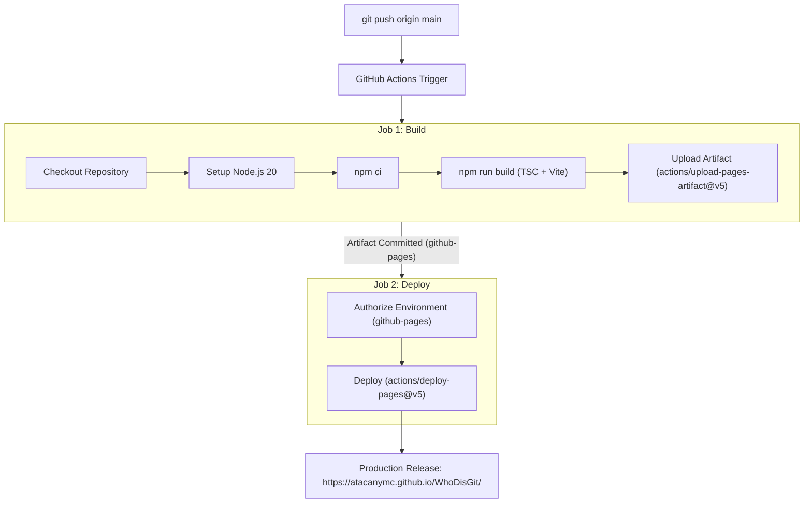

<!-- well-document · audit scorecard: G1:5 G2:5 G3:5 G4:5 G5:5 G6:5 · STATUS: PASS -->

[← Back to Documentation Index](README.md) · [Root Repository](../README.md)

# Deployment and CI/CD Pipeline Guide

This guide defines the deployment architecture, GitHub Pages hosting configuration, asset resolution mechanics, and manual release procedures for WhoDisGit.

---

## Table of Contents

- [Deployment Architecture](#deployment-architecture)
- [Automated Pipeline: GitHub Actions](#automated-pipeline-github-actions)
  - [Two-Stage Job Architecture](#two-stage-job-architecture)
  - [Workflow Definition](#workflow-definition)
  - [Permission Boundaries](#permission-boundaries)
- [Base URL & Asset Resolution](#base-url--asset-resolution)
- [Manual Deployment Fallback](#manual-deployment-fallback)
- [Local Build Verification](#local-build-verification)

---

## Deployment Architecture

WhoDisGit compiles to static HTML, CSS, and JavaScript bundles. The site is hosted on **GitHub Pages** with continuous delivery triggered on every push to the `main` branch.



---

## Automated Pipeline: GitHub Actions

### Two-Stage Job Architecture

To eliminate artifact indexing race conditions, the workflow separates bundle compilation from artifact deployment:

1. **`build` job**:
   - Executes `actions/checkout@v7`.
   - Caches npm dependencies and installs packages via `npm ci`.
   - Executes `tsc` type validation and Vite Rollup compilation into `./dist`.
   - Packages and uploads static assets using `actions/upload-pages-artifact@v5`.

2. **`deploy` job**:
   - Declares `needs: build` to guarantee execution begins only after the artifact is fully indexed by GitHub.
   - Restricts deployment to authorized repository branches (`main`, `master`).
   - Hands off deployment to the GitHub Pages ingress using `actions/deploy-pages@v5`.

### Workflow Definition

Location: `.github/workflows/deploy.yml`

```yaml
name: Deploy to GitHub Pages

on:
  push:
    branches:
      - main
      - master
  workflow_dispatch:

permissions:
  contents: read
  pages: write
  id-token: write

concurrency:
  group: 'pages'
  cancel-in-progress: true

jobs:
  build:
    runs-on: ubuntu-latest
    steps:
      - name: Checkout Repository
        uses: actions/checkout@v7

      - name: Setup Node.js
        uses: actions/setup-node@v7
        with:
          node-version: 20
          cache: 'npm'

      - name: Install Dependencies
        run: npm ci

      - name: Build Project (TSC & Vite)
        run: npm run build

      - name: Setup Pages
        uses: actions/configure-pages@v6

      - name: Upload Artifact
        uses: actions/upload-pages-artifact@v5
        with:
          path: './dist'

  deploy:
    environment:
      name: github-pages
      url: ${{ steps.deployment.outputs.page_url }}
    runs-on: ubuntu-latest
    needs: build
    steps:
      - name: Deploy to GitHub Pages
        id: deployment
        uses: actions/deploy-pages@v5
```

### Permission Boundaries

- `contents: read`: Authorizes read-only access to repository commits.
- `pages: write`: Authorizes mutating the GitHub Pages release state.
- `id-token: write`: Authorizes OpenID Connect (OIDC) token generation for secure deployment verification.

---

## Base URL & Asset Resolution

GitHub Pages projects are served under a subdirectory path matching the repository name (e.g. `/WhoDisGit/`).

To prevent broken asset references for CSS stylesheets, JavaScript chunks, and favicon images, `vite.config.js` sets relative asset addressing:

```javascript
export default defineConfig({
  base: './', // Relative paths ensure assets resolve across custom domains and subpaths
  // ... plugins and config
});
```

---

## Manual Deployment Fallback

If continuous delivery workflows are disabled or unavailable, WhoDisGit can be compiled and published manually from a developer workstation using the `gh-pages` package:

```bash
# 1. Compile bundle and publish to gh-pages branch
npm run deploy

# Or using the Makefile shortcut:
make deploy
```

---

## Local Build Verification

Before committing changes or opening pull requests, verify the production build locally:

```bash
# 1. Run type check and bundle compilation
npm run ci
# Or: make ci

# 2. Preview the production output locally on http://localhost:4173
npm run preview
# Or: make preview
```
