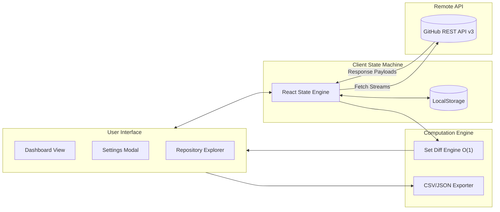

<!-- well-document · audit scorecard: G1:5 G2:5 G3:5 G4:5 G5:5 G6:5 · STATUS: PASS -->

[← Back to Root Repository](../README.md)

# Technical Documentation Index

This directory contains the engineering documentation, architectural specifications, and integration guides for WhoDisGit.

---

## Documentation Index

| Document | Scope | Target Audience |
| :--- | :--- | :--- |
| [Architecture Specification](ARCHITECTURE.md) | Client-side execution model, state machine, and $O(1)$ set-difference matching algorithms. | Maintainers, Contributors |
| [GitHub API Integration](API_INTEGRATION.md) | REST API v3 endpoints, pagination traversal, rate-limit quotas, and deep linking parameters. | Integrators, API Developers |
| [Theming and Internationalization](THEMING_AND_I18N.md) | Tailwind CSS v4 styling, color-scheme synchronization, and 5-locale translation dictionary architecture. | Frontend Developers, Translators |
| [Deployment & Pipeline Guide](DEPLOYMENT.md) | GitHub Actions two-stage deployment pipeline, asset paths, and local deployment workflows. | DevOps, Maintainers |

---

## Architecture Summary

---

## Navigation & Standards

All documents in this directory adhere to the anti-AI-slop governance rules:
- Verifiable reproduction commands.
- Zero inline emojis and no promotional hyperbole.
- Strict period-terminated sentences with no long dashes.
- Grounded file references matching the repository structure.
